<!--
  ✦ Vij: replace YOUR-LIVE-LINK (2 places: the top links and the "visit" line under them) with your Vercel link. ✦
-->

<p align="center">
  
</p>

<h1 align="center">✦ Pip's Midnight Nursery ✦</h1>

<p align="center">
  <i>“I build the dreams you fall asleep inside.”</i><br/>
  the homepage of <b>Pip</b>, Junior Dream Engineer at the Midnight Nursery
</p>

<p align="center">
  <a href="https://hax.baby/baby-problem"></a>
  
  <br/>
  
  
  
  
  
  
  
</p>

<p align="center">
  <a href="https://YOUR-LIVE-LINK.vercel.app"><b>🌙 visit the nursery</b></a> &nbsp;·&nbsp;
  <a href="#tour">🗺️ take the tour</a> &nbsp;·&nbsp;
  <a href="#brief">✅ the brief, ticked off</a> &nbsp;·&nbsp;
  <a href="#credits">📜 credits</a>
</p>

<p align="center"><sub>live at <b>https://YOUR-LIVE-LINK.vercel.app</b></sub></p>

<p align="center">
  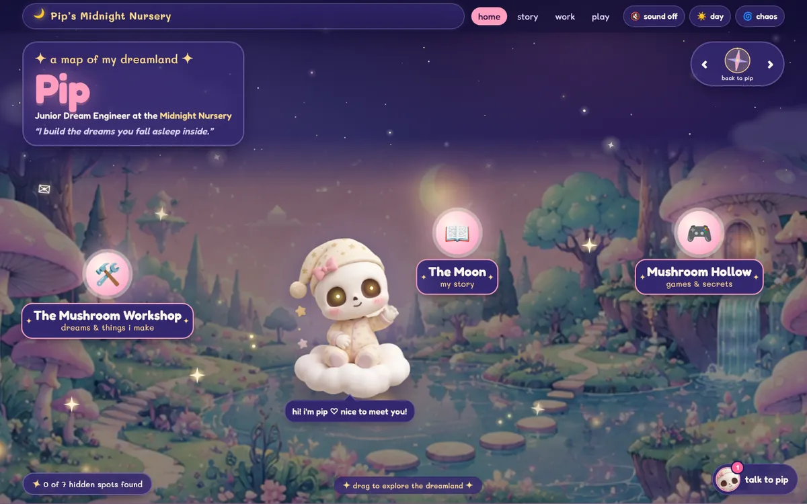
</p>

---

## hi! i'm pip ♡

*psst. come closer, the moths are sleeping.*

I'm a baby with a face made of moonlight and two little stars stuck in my eyes. I work the night shift at the Midnight Nursery, where I build the dreams you fall asleep inside. I'm sleepy, a tiny bit clumsy, and **very** against silence.

This is my website. You can explore my whole dreamland, read how I was born, build a dream with me, play my games, and leave a wish on my wall. I'll remember you when you come back. Promise. 🌙

<details>
<summary><b>📚 what's inside (the table of contents)</b></summary>

- [🌙 how i was born](#story)
- [🗺️ a tour of my dreamland](#tour)
- [✨ the dream workshop](#workshop)
- [🛠️ things i make](#make)
- [🎮 games & secrets](#games)
- [💬 talk to me](#chat)
- [🌀 chaos mode (welcome to 1999)](#chaos)
- [📱 pocket-sized pip](#phones)
- [🥚 secrets (spoilers!)](#secrets)
- [✅ the brief, ticked off](#brief)
- [📟 early-web soul](#early-web)
- [⚡ fast, gentle & kind to everyone](#speed)
- [🧰 how it's built](#built)
- [📜 credits](#credits)
</details>

---

<a id="story"></a>

## 🌙 how i was born

### *The Dream Nobody Dreamed*

Long ago, a little ghost named **Wisp** couldn't fall asleep, because nobody sang to them. So the dream meant for that night was never dreamed. It drifted past the moon, *bonked* into a chimney… and woke up as **me**.

**Nana Noctua**, the wise old owl who runs the nursery, found me in the lost-and-found between a sock and a very grumpy mitten. She tucked a nightcap on my head and said *“every lost thing has a job here, little one.”* I hummed my first wobbly lullaby, built Wisp a real dream, and became the Junior Dream Engineer.

The story is told in **6 scroll-driven scenes**: you scroll, and the dream-orb rises, flies past the moon and lands with a *bonk*. No walls of text, about 40 words a scene.

<p align="center">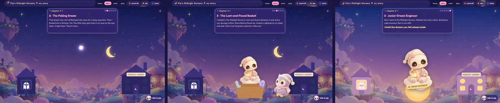</p>

---

<a id="tour"></a>

## 🗺️ a tour of my dreamland

### the dream cartographer (home)

My home page is a **living map**. I float on my cloud in the middle of the mushroom pond, and everything else is somewhere out there.

- **drag, swipe, use ← → or the compass** to explore. the compass always brings you back to me.
- **three big banners** are my pages: 📖 **The Moon** (my story), 🛠️ **The Mushroom Workshop** (things i make), 🎮 **Mushroom Hollow** (games & secrets).
- **seven hidden spots** twinkle in the painting. hover or tap one to reveal it (it turns pink once found!). the little counter in the corner keeps score, and if you get stuck, tap it and i'll point you to the next one. find all 7 for a surprise ✦
- **pick any place** and a trail of stardust appears. i fly along it, the map follows me, and *whoosh*, you're there.
- at **night** the windows flicker, the waterfall shimmers, fireflies drift and a tiny mail plane crosses the sky. by **day** i'm asleep (shh) and everything turns pastel.

| a hidden spot, found | daytime (i'm napping) |
|:---:|:---:|
| 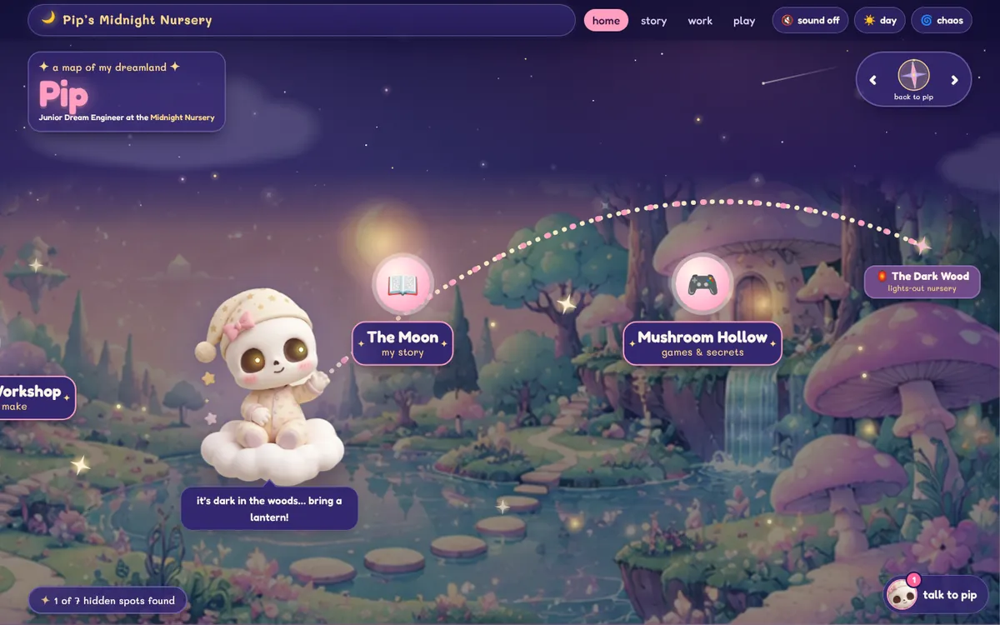 | 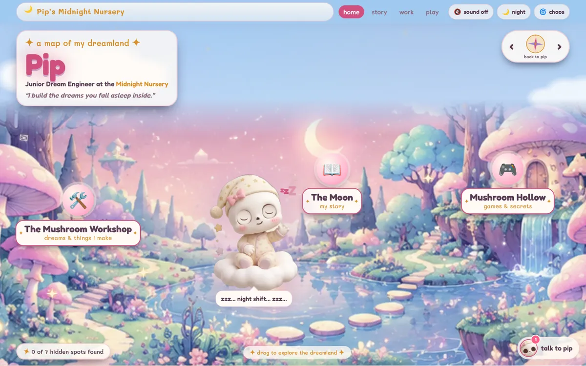 |

> **pip's note:** my eyes follow your cursor (or your finger!), i blink, and i look around when you're quiet. boop my nose. go on. 👃

---

<a id="workshop"></a>

## ✨ the dream workshop

**This is my actual job, and now you get to do it too.**

Pick four ingredients (**who** the dream is for, the **mood**, the **place** and the **sound**) or tap 🎲 *surprise me*, and I fly in and build it:

- 🎨 **a little animated scene.** 5 hand-drawn places (the moon, a cloud castle, under the sea, a cookie forest, the midnight train), and the mood sets how everything moves: silly dragons wobble, brave bears hop, floaty socks drift upward.
- 📖 **a bedtime story** written from your choices.
- 🎶 **its very own lullaby.** the mood shapes the melody and the tempo, the sound picks the instrument, and the same dream always gets the same song.
- 🫙 keep it on your **dream shelf** (glowing jars!), 🔗 **share it as a link** that opens the exact same dream for a friend, or 📌 **pin it to the Dream Wall**.

6 × 5 × 5 × 4 = **600 possible dreams.** I have built all of them. (I have not built all of them.)

<p align="center">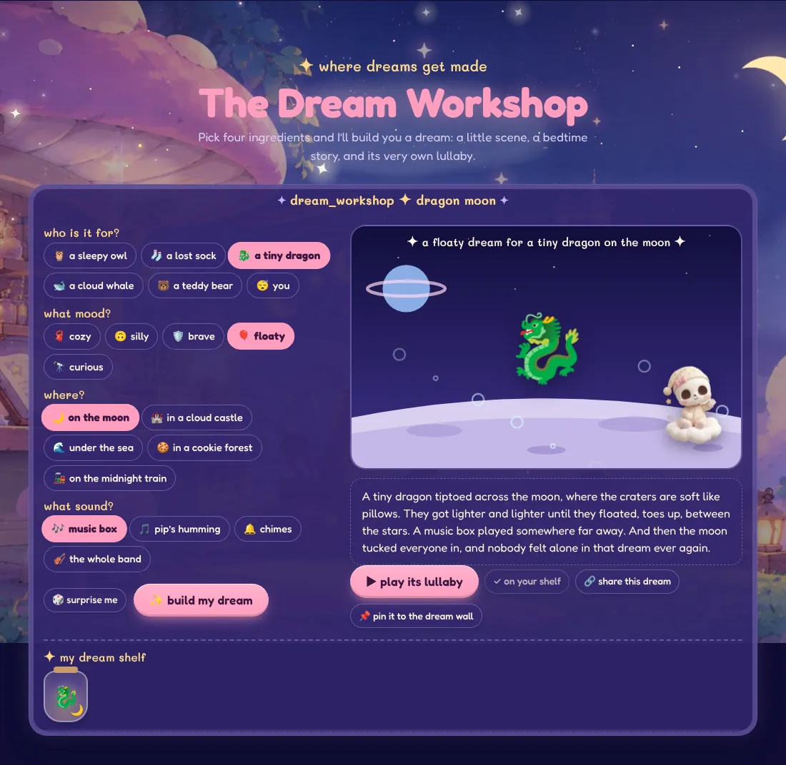</p>

---

<a id="make"></a>

## 🛠️ things i make

| | |
|:---:|:---:|
| 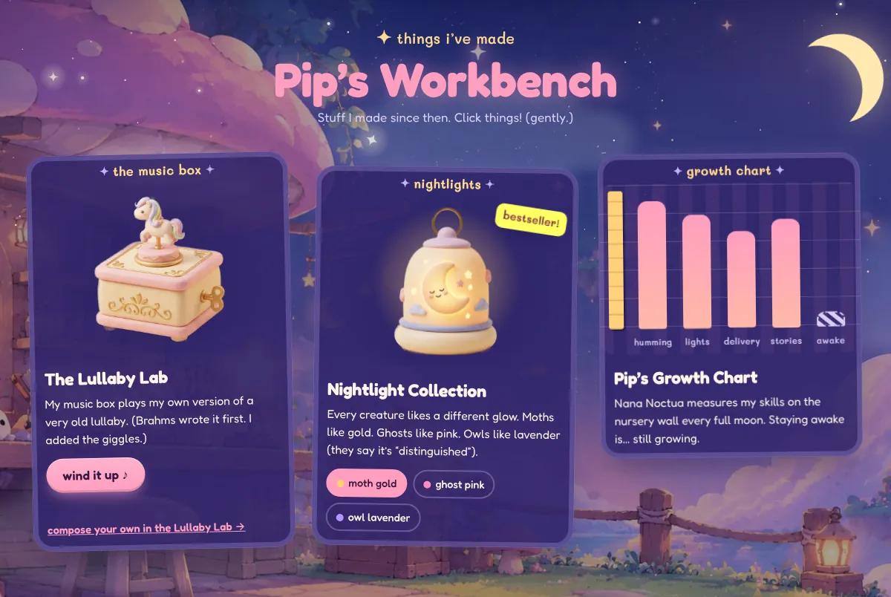 | 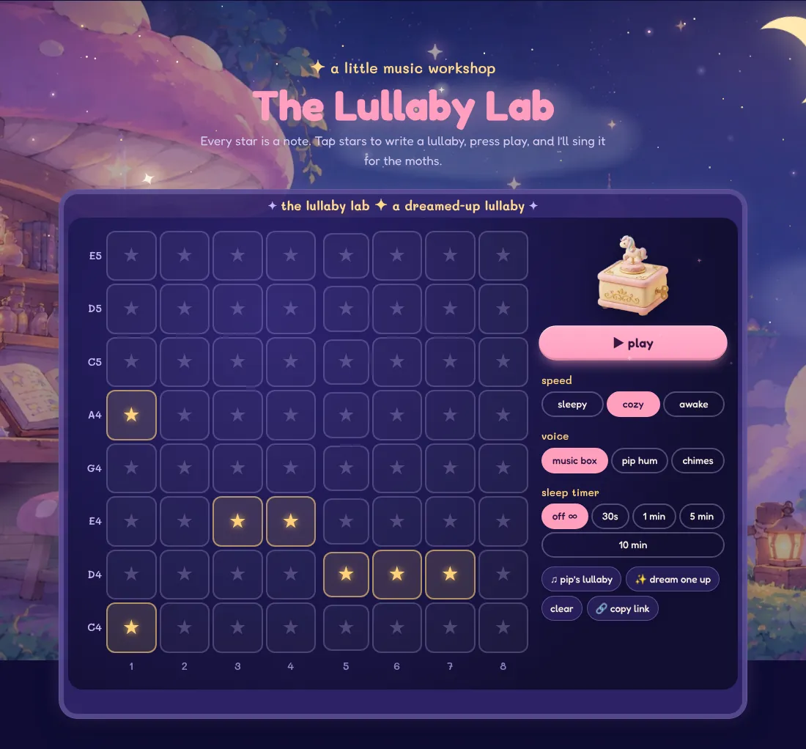 |
| **my workbench:** wind up the music box (Brahms wrote it first, i added the giggles), pick a nightlight glow, watch my growth chart grow | **the lullaby lab:** an 8×8 star-grid music maker. every star is a note (a pentatonic scale, so nothing ever sounds scary). 3 voices, 3 speeds, a sleep timer that fades out, and shareable `#lullaby=` links |
| 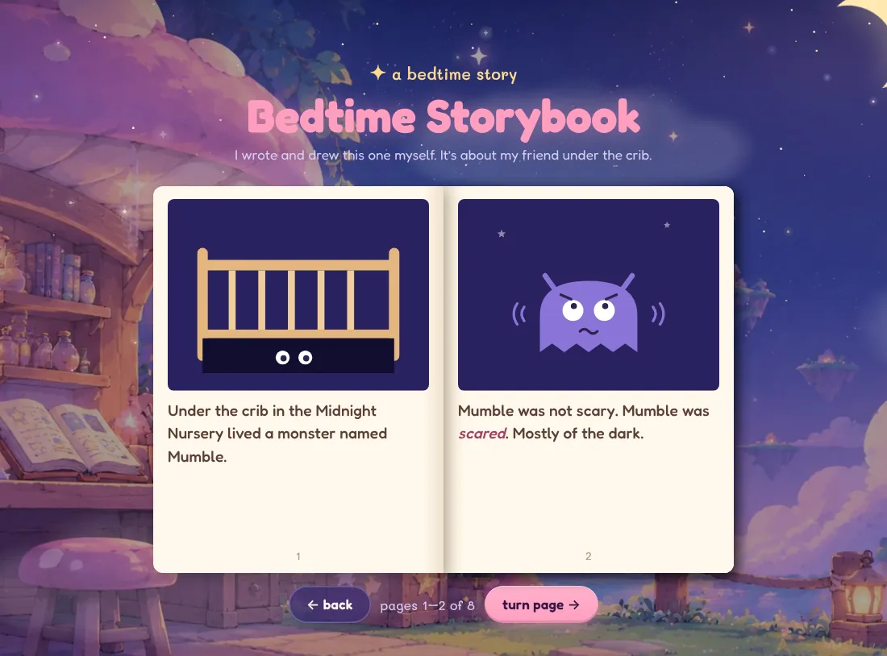 | 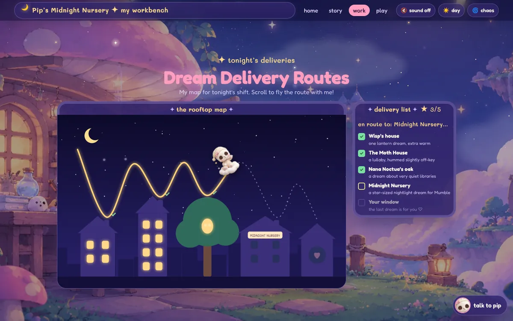 |
| **bedtime storybook:** *Mumble and the Very Big Dark*, an original picture book with real 3D page turns. buttons, ← → keys, swipe or tap | **dream delivery routes:** scroll, and my flight path draws itself across town. each rooftop lights up as a dream drops down its chimney |

---

<a id="games"></a>

## 🎮 games & secrets

| | |
|:---:|:---:|
| 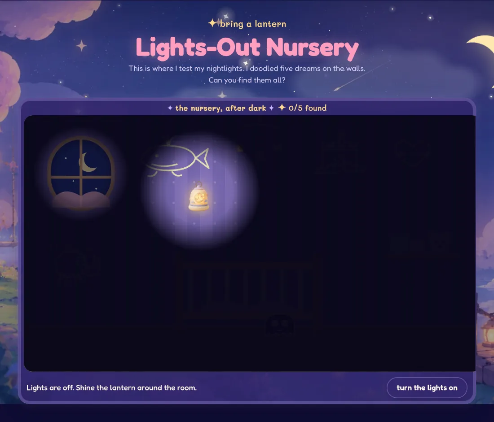 | 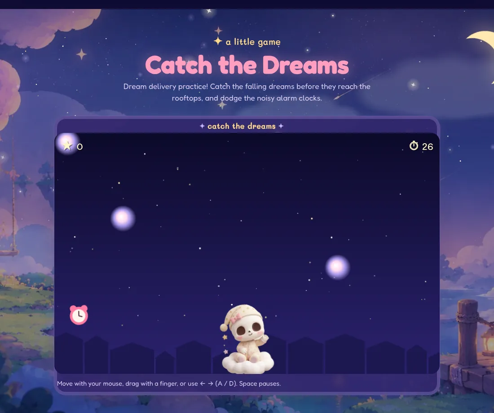 |
| **lights-out nursery:** the lights are off and your cursor (or finger) is my lantern. find the 5 doodles i hid on the walls | **catch the dreams:** a 30-second dream-delivery shift. catch falling dreams, build combos, dodge the grumpy alarm clocks |
| 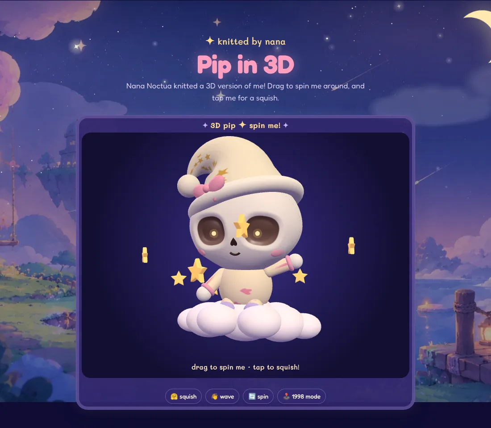 | 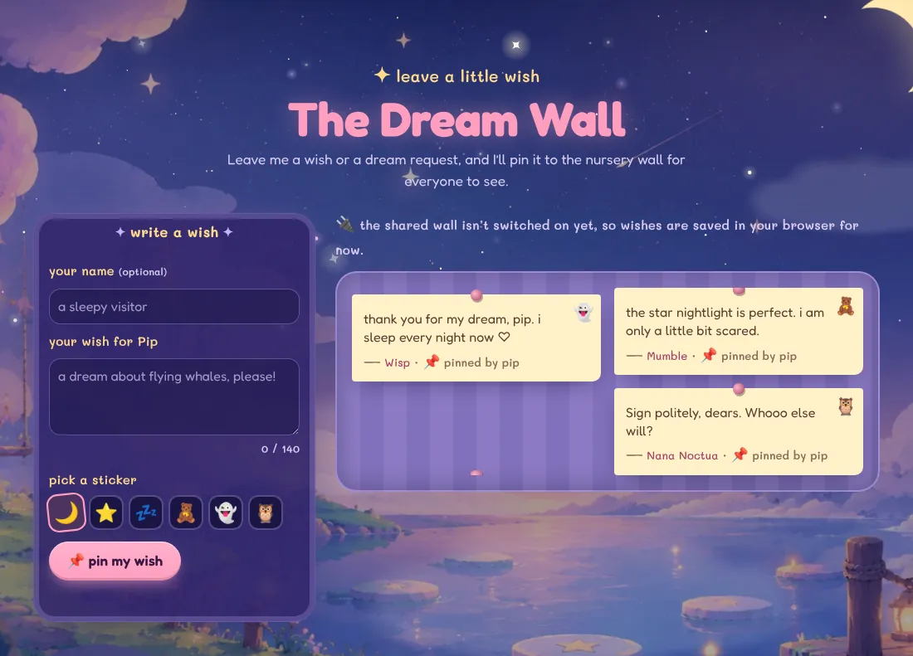 |
| **pip in 3D:** Nana knitted a 3D me (built from shapes in Three.js). drag to spin, tap to squish, try the *1998 low-poly* mode | **the dream wall:** a real live guestbook. leave me a wish and everyone sees it ♡ |

---

<a id="chat"></a>

## 💬 talk to me

Tap **talk to pip** on any page. I know about **35 things** (my story, my friends, lullabies, secrets, jokes, the time, and building dreams), there are buttons to tap so you never have to think of a question, and some answers *do* things: I'll sing, open a page, or flip day and night for you. I also remember your name. No AI service, just me, so it's instant and works offline.

<p align="center">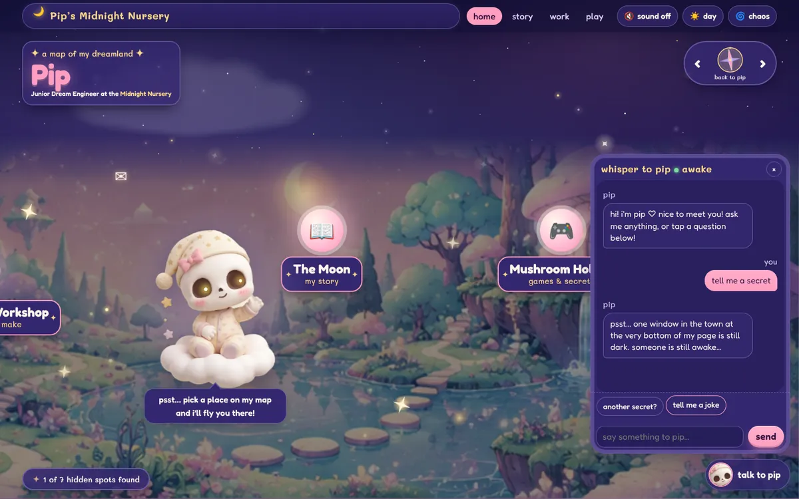</p>

---

<a id="chaos"></a>

## 🌀 chaos mode (welcome to 1999)

Press 🌀 and my site turns into a 1999 homepage: rainbow window bars, spinning stickers (*cool site award 1999 · best viewed in Dreamscape 4.0 · 🌙 web ring member*), a live **“best viewed at W×H (that's you!)”** badge, and a bouncing-me screensaver. It's **responsive chaos**: it reshapes itself to your screen, scales the stickers to your screen size and re-tilts everything when you resize.

<p align="center">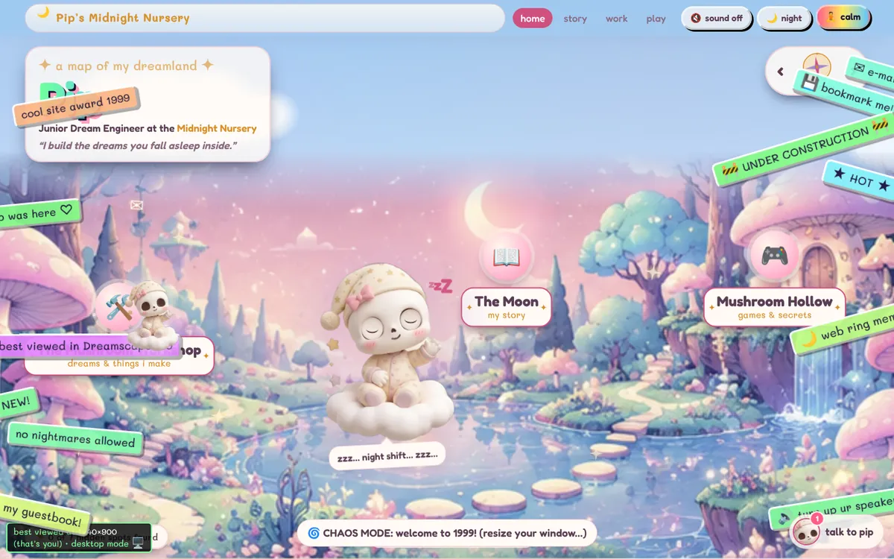</p>

---

<a id="phones"></a>

## 📱 pocket-sized pip

Built for phones first: swipe the map, tap twice on hidden spots (once to peek, once to fly), and the story scenes re-stage themselves for tall screens.

<p align="center">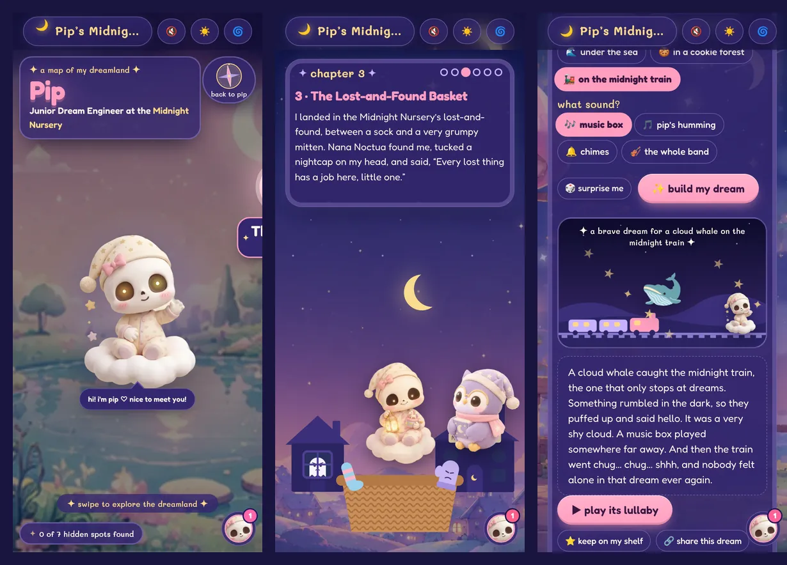</p>

---

<a id="secrets"></a>

## 🥚 secrets (spoilers!)

<details>
<summary><b>only open if you've already looked for them yourself 👀</b></summary>

- 🏠 **someone in town is still awake.** one window in the footer town is dark. click it.
- 👃 **boop my nose five times.** a… a… *ACHOO!* ✨
- ⭐ **seven hidden spots** are tucked into the home map. find them all and i throw a tiny party.
- 🧑‍💻 **open your browser console.** i left you a note.
- 🌀 **chaos mode** changes personality depending on your screen's shape.
- 🧠 **come back tomorrow.** i'll remember your name, how long you were away, what you found, and your best dream-catching score (all kept in *your* browser, with a “forget me” button).
</details>

---

<a id="brief"></a>

## ✅ the brief, ticked off

Built for [**Baby's First Website**](https://hax.baby/baby-problem) by haX.baby, 17–19 Oct 2026, **Track 1: the skull baby**.

<table>
<tr><th>required in every entry</th><th></th><th>where</th></tr>
<tr><td>what pip is</td><td>✅</td><td>the title card on the map + the <i>all about me</i> window</td></tr>
<tr><td>what pip does (3+ things)</td><td>✅</td><td>workbench (music box, nightlights, growth chart) + lullaby lab, storybook, delivery routes, dream workshop</td></tr>
<tr><td>his story (not a wall of text)</td><td>✅</td><td>6 scroll-driven scenes, ~40 words each</td></tr>
<tr><td>immersion</td><td>✅</td><td>eyes follow cursor / finger, nose boop, click sounds, a mute switch always in the top bar</td></tr>
<tr><td>mobile-friendly</td><td>✅</td><td>phone-first, tested on real phones</td></tr>
<tr><td>a hidden Easter egg</td><td>✅</td><td>several, see above 🥚</td></tr>
</table>

| tier 1 · complete portfolio | | tier 2 · memorable standout | | tier 3 · legendary | |
|---|:---:|---|:---:|---|:---:|
| reacts to cursor (+ touch) | ✅ | lullaby lab with real audio + mute | ✅ | 3D Three.js pip you can spin | ✅ |
| scroll-driven story | ✅ | flashlight cursor (canvas mask) | ✅ | live dream guestbook (real backend) | ✅ |
| day/night that changes expression + palette | ✅ | dream delivery map synced to scroll | ✅ | returning-visitor memory | ✅ |
| crisp on small phones | ✅ | storybook with page-flip, touch + keys | ✅ | pip chats back, in character | ✅ |
| a discoverable Easter egg | ✅ | mini-game: catch the dreams | ✅ | Lighthouse 90+ | ✅ |

| side quest | points | |
|---|:---:|---|
| 📌 live guestbook wall | +2 | ✅ the Dream Wall (Vercel function + Upstash Redis, rude words and links blocked, plain-text rendering) |
| ✨ sparkle cursor trail | +2 | ✅ theme-aware glitter, rainbow in chaos mode, off for reduced motion |
| 🔢 hit counter odometer | +1 | ✅ a rolling odometer in the footer, counted site-wide |
| 🔊 click sounds + mute | +3 | ✅ buttons rattle, links wind-chime, mute switch always visible (sound starts **off**) |
| 🌀 responsive chaos mode | +5 | ✅ see above |
| | **+13** | 🎉 |

**Bonus:** ✨ the Dream Workshop, the living map with 7 hidden spots, and the painted Story / Work / Play pages.

---

<a id="early-web"></a>

## 📟 early-web soul

Under the dreamy paint, this is a proper little old-school homepage:

- 🪟 every panel is a cozy **window** with a title bar and `_ □ ×` buttons
- 🔢 a rolling **hit counter odometer** and a real **guestbook**
- 🏷️ tiny **88×31-style badges** in the footer (*best at 2 a.m. · made w/ &lt;HTML&gt; · 0 nightmares ✓ · Pip approved*)
- 📜 a scrolling **marquee ribbon** (*★ now accepting dream requests ★ please do not wake the moths ★*)
- 🌀 a full **1999 chaos mode** with stickers, a web-ring badge and a bouncing screensaver
- 🏘️ a **footer town** with a secret window, a console note for curious people, and an address bar sign: *🌙 Pip's Midnight Nursery*
- 💾 hand-written **HTML, CSS and JavaScript**, no framework, no build step, view-source friendly

---

<a id="speed"></a>

## ⚡ fast, gentle & kind to everyone

| Lighthouse (measured locally, served compressed) | mobile | desktop |
|---|:---:|:---:|
| performance | 91–94 | 99–100 |
| accessibility | 100 | 100 |
| best practices | 96 | 96 |
| SEO | 100 | 100 |

How I stay quick even with a big painted map:
- the map art is cut into tiles and is **never shown bigger than its real size**, so it's always sharp. the tiles near me load first, and a blurry ½ KB preview shows instantly while the rest arrive.
- each page's code only loads the first time you open that page, then the others are fetched quietly in the background.
- sections below the fold aren't laid out until you scroll near them; nothing invisible animates; no layout jumps.
- the sky paints a still frame first, then starts twinkling once the page settles.
- **every CSS/JS file is version-stamped**, so after a deploy no browser ever mixes old and new files.

And kind:
- 🔇 sound always starts **off**, and the mute switch is always one tap away
- 🐢 **reduced motion** is respected everywhere (the map holds still, i fly instantly)
- ⌨️ everything works with a **keyboard**: tab to places on the map, ← → to pan, Enter to fly
- 🏷️ real labels, alt text and live regions for screen readers
- 🔒 memories, the dream shelf and lullabies live **only in your browser**

---

<a id="built"></a>

## 🧰 how it's built

**Plain HTML, CSS and JavaScript modules.** No framework, no bundler, no build step. Three.js is the only library, and it only loads for 3D Pip.

| | |
|---|---|
| 🎵 sound | every note is synthesized live with the **Web Audio API** (music box, humming, chimes, giggles, the sneeze) |
| 🎨 art | WebP images, hand-drawn **SVG**, CSS gradients, and **Canvas 2D** for the sky, the game and the lantern room |
| 🧸 3D | **Three.js** r160 with a custom shader for Pip's glowing eyes |
| 🗄️ backend | two tiny **Vercel functions** (`api/hits.js`, `api/guestbook.js`) on **Upstash Redis** |
| 🧠 memory | `localStorage` for visitor memory, the dream shelf and saved lullabies |

### run it locally

```bash
python3 -m http.server 8080      # then open http://localhost:8080
```

(ES modules need a server, so double-clicking `index.html` won't load the JavaScript. The hit counter and guestbook fall back gracefully without the backend.)

### deploy

```bash
python3 stamp.py                 # version-stamp the CSS/JS (do this before every deploy)
git push                         # Vercel picks it up
```

For the live hit counter and guestbook, connect **Upstash Redis** in Vercel. It provides `KV_REST_API_URL` and `KV_REST_API_TOKEN` (or `UPSTASH_REDIS_REST_URL` / `_TOKEN`).

<details>
<summary><b>🗂️ where everything lives</b></summary>

```
index.html          every page lives here (home / story / work / play)
css/style.css       all the styles, day + night + chaos
stamp.py            version-stamps CSS/JS before deploys
vercel.json         cache headers
api/
  hits.js           site-wide hit counter (Vercel function + Upstash Redis)
  guestbook.js      the Dream Wall (Vercel function + Upstash Redis)
js/
  main.js           wires everything together, loads each page's code on first visit
  router.js         home / story / work / play, plus shared links (#lullaby=, #dream=)
  dreammap.js       the living map: places, hidden spots, stardust trails, Pip's flights
  workshop.js       the Dream Workshop: scenes, stories, lullabies, shelf, share links
  sky.js            the living sky: twinkling stars, sparkles, shooting stars, dream-motes
  eyes.js           eyes that follow you, blink and wander
  story.js          the scroll-driven origin story
  toys.js           the workbench projects
  lab.js            the Lullaby Lab sequencer
  storybook.js      the flip-page storybook
  routes.js         Dream Delivery Routes
  nightroom.js      Lights-Out Nursery (the lantern cursor)
  game.js           Catch the Dreams
  pip3d.js          3D Pip (Three.js)
  guestbook.js      the Dream Wall
  chat.js           whisper to pip (Pip chats back)
  memory.js         Pip remembers you
  counter.js        the hit counter odometer
  chaos.js          Responsive Chaos Mode
  sparkles.js       sparkle cursor trail
  clicks.js         click sounds
  eggs.js           secrets
  audio.js          the Web Audio synth
  fx.js             speech bubble, toasts, star sparks
  theme.js          day / night
  vendor/           three.module.min.js + its MIT licence
assets/             images (WebP), fonts, map tiles, page paintings
docs/screenshots/   the pictures in this README
```
</details>

---

<a id="credits"></a>

## 📜 credits

- **Pip, the music box and the lantern:** the official haX.baby Track 1 asset pack. Backgrounds removed; the eye glints were painted out and are redrawn live in CSS so they can follow you. The story uses the pack's portrait of Pip, with its lettering painted out.
- **Nana Noctua illustration:** added by Vij for this site.
- **The dreamland map:** an AI-generated painting chosen by Vij, shown at its original resolution (cut into tiles, nothing upscaled).
- **The Story, Work and Play paintings:** added by Vij for this site (the moon painted out of each so the site's own moon can shine).
- **Wisp, Mumble, the town, the storybook pictures, the Dream Workshop scenes, the basket and the grumpy mitten:** hand-drawn SVG for this site. The bedtime stories are original.
- **Lullaby melody:** Johannes Brahms, *Wiegenlied* Op. 49 No. 4 (1868, public domain). Every sound is synthesized in the browser.
- **Fonts:** [Fredoka](https://fonts.google.com/specimen/Fredoka) via Google Fonts; [Mali](https://fonts.google.com/specimen/Mali) by Cadson Demak (SIL Open Font License), bundled with its licence.
- **3D:** [Three.js](https://threejs.org) r160 (MIT licence).
- **Badges:** [shields.io](https://shields.io).
- Built by **Vij** ([@VijayaY836](https://github.com/VijayaY836)) with AI assistance (Claude).

---

### 🏷️ tags

`haxbaby` · `babys-first-website` · `hackathon` · `pip` · `skull-baby` · `character-portfolio` · `interactive-storytelling` · `creative-coding` · `vanilla-js` · `web-audio-api` · `canvas` · `svg-animation` · `threejs` · `vercel` · `upstash-redis` · `early-web` · `y2k` · `cozy-web` · `retro-web` · `accessibility`

---

<p align="center">
  <br/>
  <i>goodnight! come back when you can't sleep ♡</i><br/>
  <sub>© 1999–2026 Pip · all dreams reserved · last updated tonight, 2:14 a.m.</sub>
</p>